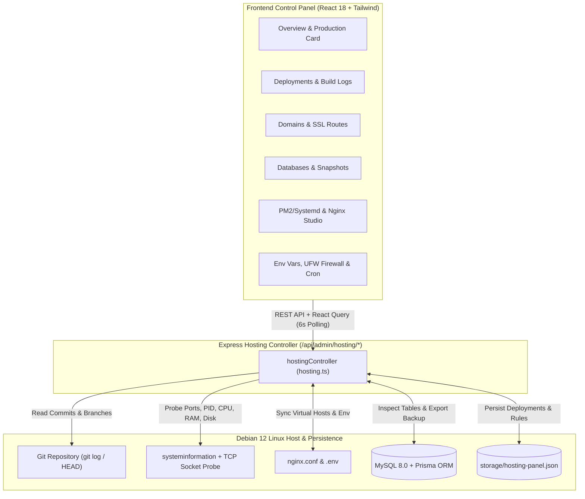

# ▲ IT-Hub Edge & Web Hosting Control Panel (Vercel-Style)

Panel kontrol *Web Hosting*, *Edge Deployment*, dan *Server Infrastructure* bergaya **Vercel Dashboard** untuk ekosistem **Personal IT Hub** (Debian 12 GNU/Linux).

---

## ✨ Fitur Utama

1. **Production Deployment Overview (`Overview`)**
   - Kartu pratinjau langsung (*Live Browser Preview Frame*) dengan status `200 OK`, indikator SSL, serta metrik *real-time* CPU, RAM, dan Uptime.
   - Informasi lengkap *Deployment URL*, daftar domain produksi, status `● Ready`, waktu *build*, *Edge Region* (`dps1 — Bali Edge Node`), serta integrasi *branch* & *commit hash* Git.
   - Panel **Expandable Build Logs & Runtime Verification** langsung di kartu utama.

2. **Deployment History & Instant Rollback (`Deployments`)**
   - Membaca riwayat *commit* Git asli dari repositori lengkap dengan filter *Environment* (`ALL`, `Production`, `Preview`) dan pencarian cepat.
   - **Trigger New Deployment / Redeploy**: Menjalankan *build pipeline* baru ke *Production* atau *Preview* dari *branch* mana pun.
   - **Instant Rollback / Promote to Production**: Mengalihkan trafik produksi ke *deployment* versi sebelumnya hanya dengan satu klik.
   - **Build Log Inspector**: Menampilkan log tahapan kompilasi (`tsc`, `vite build`, validasi Prisma, dan *routing* Nginx/Cloudflare).

3. **Custom Domains, Reverse Proxy & SSL Manager (`Domains`)**
   - Manajemen *Virtual Host* Nginx (`reverse_proxy`, `static`, `php_fastcgi`) dengan lencana **Valid Configuration**.
   - Pengaturan **SSL/TLS Provider** (*Cloudflare Edge SSL*, *Let's Encrypt*, *Self-Signed*), *Force HTTPS*, dan *HTTP/2*.

4. **Database Manager & Snapshot Backups (`Storage & Databases`)**
   - Provisioning database & user baru (`MySQL 8.0`, `PostgreSQL 16`, `SQLite 3`).
   - **Live Prisma / MySQL Table Inspector**: Memantau jumlah baris (*live rows*) dan ukuran tabel secara langsung.
   - **One-Click Snapshot Backup**: Ekspor cadangan data ke `storage/backups/`.

5. **Runtime Daemons & Nginx Config Studio (`Runtime & Nginx Logs`)**
   - Kontrol *live* siklus `Start`, `Restart`, `Reload`, dan `Stop` untuk layanan PM2 dan Systemd (`nginx`, `it-hub-frontend`, `it-hub-backend`, `omni-ai`, `cyberlab-lks`, `devkit-toolkit`, `mysql`, `cloudflared`).
   - Editor langsung `nginx.conf` dengan sinkronisasi otomatis dari daftar *Virtual Host* + *Audit Logs*.

6. **Environment Variables, Firewall (UFW) & Cron Jobs (`Firewall, Cron & Env`)**
   - Manajemen variabel `.env` terenkripsi/tersamar (`••••••••`) dengan fitur *Reveal/Hide* untuk target `Production`, `Preview`, dan `Development`.
   - Pengaturan aturan port **Firewall (UFW)** (`ALLOW`, `DENY`, `LIMIT`), pemindai port `LISTEN` kernel Linux, serta eksekusi **Cron Jobs** terjadwal (`Run Now`).

---

## 🔄 Arsitektur & Alur Kerja Monitoring



---

## 📁 Struktur Direktori

```
├── backend/
│   ├── hosting.ts          # Express Controller (Deployments, Env, VHosts, Services, DB, UFW, Cron)
│   └── routes.ts           # Express Admin Router (/api/admin/hosting/*)
├── frontend/
│   ├── HostingPanel.tsx    # Komponen Utama UI Vercel-Style Control Panel
│   └── hostingApi.ts       # Klien HTTP API Frontend
├── nginx.conf              # Konfigurasi Reverse Proxy Multi-Domain
├── package.json            # Metadata Modul Control Panel
└── README.md               # Dokumentasi Arsitektur & Fitur
```
