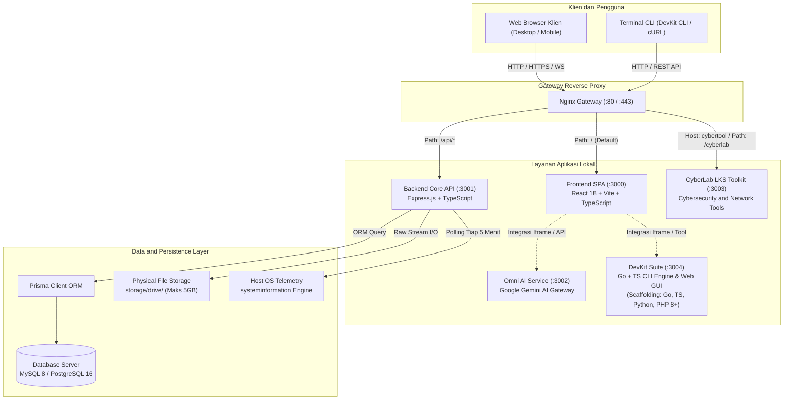
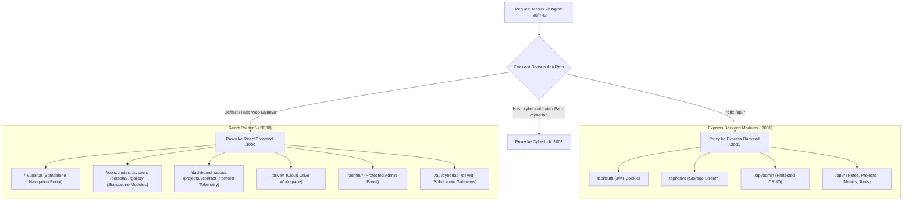
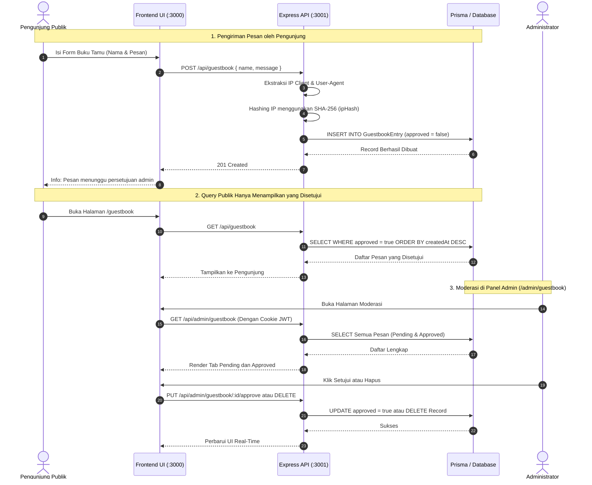
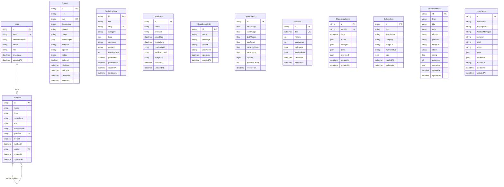
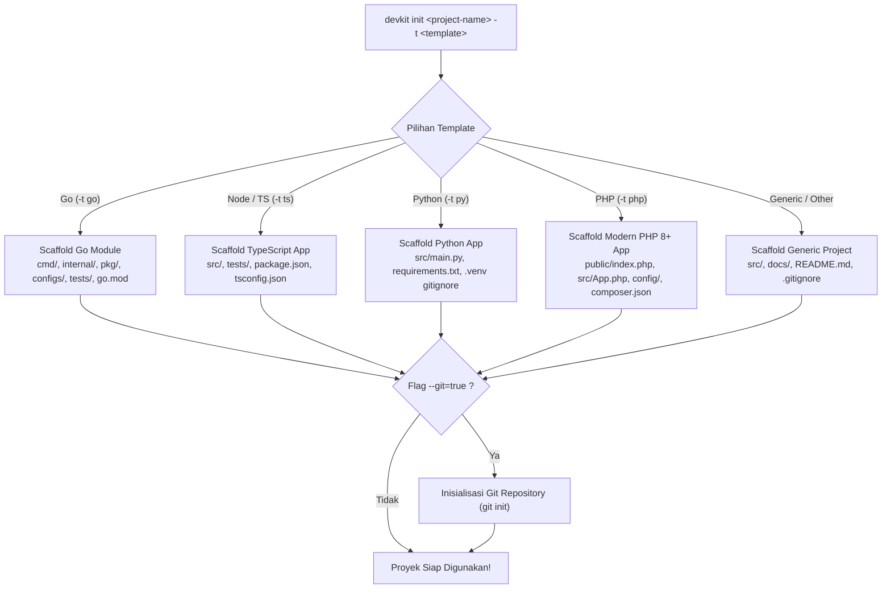

# Diagram Arsitektur & Alur Kerja Personal IT Hub (Fixed & Verified)

Dokumen ini memuat kumpulan diagram teknis murni Mermaid yang telah diverifikasi sintaksnya agar dapat dirender dengan sempurna di semua renderer Mermaid (GitHub, VS Code, Antigravity, dan Mermaid Live Editor).

---

## 1. Topologi Arsitektur Ekosistem & Multi-Port (Fixed)

---

## 2. Diagram Alur Routing & Pemilahan Request Nginx (Fixed)

---

## 3. Diagram Hirarki Tata Letak Frontend (Fixed)

```mermaid
graph TD
    AppRoot["App.tsx (Root Provider & ErrorBoundary)"] --> Router["React Router 6 (Lazy Loading)"]

    subgraph LayoutShells["Layout Shells"]
        PortalShell["Standalone Portal Shell (/ & /portal)<br/>Top Header + Hero Anime Banner + Directory"]
        StandaloneModuleLayout["StandaloneModuleLayout<br/>Independent Top Bar + Back to Portal + Clean View"]
        DashboardLayout["DashboardLayout<br/>Collapsible Sidebar + Header + Portfolio Views"]
        AdminLayout["AdminLayout<br/>Sidebar Admin + Breadcrumb + CRUD Workstations"]
        DriveLayout["DriveLayout<br/>Drive Sidebar + Toolbar + File Grid + Quota"]
        AuthLayout["AuthLayout<br/>Centered Secure Dark Shell"]
    end

    Router -->|"Root Gateway /"| PortalShell
    Router -->|"Modul Independen"| StandaloneModuleLayout
    Router -->|"Portofolio & Telemetri"| DashboardLayout
    Router -->|"Rute Admin /admin/*"| AdminLayout
    Router -->|"Rute Drive /drive/*"| DriveLayout
    Router -->|"Rute Auth /admin/login"| AuthLayout

    subgraph ViewsStandalone["Modul Independen Portal"]
        StandaloneModuleLayout --> UnifiedTools["Unified Tools & Network Diagnostics (/tools)"]
        StandaloneModuleLayout --> NotesView["Technical Notes & Guides (/notes)"]
        StandaloneModuleLayout --> SystemView["System Telemetry & Specs (/system, /status)"]
        StandaloneModuleLayout --> MediaView["Personal Media (/personal) & Visual Gallery (/gallery)"]
        StandaloneModuleLayout --> LinuxView["Linux Rice & Dotfiles Setup (/linux-setup)"]
    end

    subgraph ViewsPublik["Halaman Portofolio & Dashboard"]
        DashboardLayout --> PortfolioHome["Dashboard Overview (/dashboard)"]
        DashboardLayout --> ProjectsView["Showcase Proyek (/projects)"]
        DashboardLayout --> CertsView["Sertifikasi & Lisensi (/certificates)"]
        DashboardLayout --> GuestbookView["Buku Tamu Interaktif (/guestbook)"]
    end

    subgraph ViewsDrive["Halaman Cloud Drive"]
        DriveLayout --> MyDrivePage["MyDrive (/drive) - Folder Explorer"]
        DriveLayout --> TrashPage["Trash (/drive/trash) - Tempat Sampah"]
    end

    subgraph ViewsAdmin["Halaman Admin"]
        AdminLayout --> AdminDashboard["Admin Dashboard (Telemetry & Analytics)"]
        AdminLayout --> AdminCRUD["CRUD Projects, Notes, Gallery, Changelog, Tools"]
        AdminLayout --> AdminGuestbook["Moderasi Guestbook (Approve/Reject)"]
    end
```

---

## 4. Diagram Siklus Hidup Berkas Cloud Drive (Fixed)

```mermaid
flowchart TD
    subgraph UploadFlow["Alur Upload Berkas"]
        UserFile["Pengguna Pilih Berkas / Drag & Drop"] --> ValidateFile{"Validasi Tipe dan Nama"}
        ValidateFile -->|"Valid"| StreamUpload["POST /api/drive/upload (Multipart)"]
        StreamUpload --> ProxyPass["Nginx Forward Chunk Stream ke Backend"]
        ProxyPass --> WriteDisk["Backend Tulis Stream ke storage/drive/userId/"]
        WriteDisk --> CreateMeta["Prisma Simpan Record DriveItem di Database"]
        CreateMeta --> UploadSuccess["Respons 201 Created & Perbarui UI"]
    end

    subgraph TrashLifecycle["Alur Penghapusan dan Pemulihan"]
        ItemAction{"Aksi Pengguna"} -->|"Hapus Sementara"| SoftDelete["PUT /api/drive/:id/trash (isTrash: true)"]
        SoftDelete --> MoveToTrash["Pindah ke Tampilan Trash"]

        MoveToTrash --> TrashAction{"Aksi di Trash"}
        TrashAction -->|"Pulihkan"| RestoreItem["PUT /api/drive/:id/restore (isTrash: false)"]
        RestoreItem --> ReturnToActive["Kembali ke Folder Asal"]

        TrashAction -->|"Hapus Permanen"| HardDelete["DELETE /api/drive/:id atau /trash/empty"]
        HardDelete --> UnlinkDisk["Hapus Berkas Fisik: fs.unlinkSync"]
        UnlinkDisk --> DeleteMeta["Prisma: Hapus Record dari Database"]
    end
```

---

## 5. Pipeline Moderasi & Anti-Spam Guestbook (Fixed)

---

## 6. Diagram Relasi Entitas Basis Data Prisma / ERD (Fixed)

---

## 7. Tabel Rinci Skema Entitas Basis Data (Prisma ORM)

| Model / Entitas | Deskripsi Fungsional | Kunci Utama (PK) / Relasi | Indeks & Constraint |
| :--- | :--- | :--- | :--- |
| **`User`** | Akun autentikasi pemilik/admin workspace | `id` (CUID) → 1:N `DriveItem` | `email` (UNIQUE), Role: `ADMIN` |
| **`DriveItem`** | Berkas fisik & direktori Cloud Drive | `id` (CUID), FK: `userId`, `parentId` (Self-relation) | `@@index([parentId])`, `@@index([userId])`, `@@index([isTrash])` |
| **`Project`** | Portofolio proyek teknologi | `id` (CUID) | `slug` (UNIQUE), `status` (Enum: PLANNING, IN_PROGRESS, COMPLETED, ARCHIVED) |
| **`TechnicalNote`** | Catatan teknis & dokumentasi panduan | `id` (CUID) | `slug` (UNIQUE), `@@index([category])`, `@@index([published])` |
| **`Certificate`** | Sertifikasi & lisensi kompetensi | `id` (CUID) | `credentialId`, `verificationUrl` |
| **`GuestbookEntry`** | Buku tamu interaktif dengan anti-spam | `id` (CUID) | `ipHash` (SHA-256), `@@index([approved])`, `@@index([createdAt])` |
| **`ServerMetric`** | Riwayat telemetri performa mesin host | `id` (CUID) | `recordedAt` (DateTime), `@@index([recordedAt])` |
| **`Statistics`** | Agregasi analitik kunjungan & penggunaan tool | `id` (CUID) | `date` (UNIQUE) |
| **`ChangelogEntry`** | Catatan rilis pembaruan ekosistem | `id` (CUID) | `version` (UNIQUE) |
| **`GalleryItem`** | Arsip aset visual & fotografi | `id` (CUID) | `@@index([category])` |
| **`PersonalMedia`** | Tracker media (Anime, Musik, Game, Movie) | `id` (CUID) | `type` (Enum: GAME, MUSIC, ANIME, MOVIE) |
| **`LinuxSetup`** | Dokumentasi lingkungan OS Debian / Dotfiles | `id` (CUID) | Konfigurasi hardware, WM, shell, editor |

---

## 8. Matriks Bahasa Pemrograman & Modul Ekosistem

| Bahasa Pemrograman / Format | Modul / Komponen Workspace | Peran & Lingkup Implementasi | Tooling / Runtime |
| :--- | :--- | :--- | :--- |
| **TypeScript (`.ts`, `.tsx`)** | `frontend/`, `backend/`, `devkit-cli/src/` | Aplikasi SPA (React 18), REST API Server (Express.js), CLI TS Runner | Node.js v20+, Vite, `tsx`, `tsc` |
| **Go / Golang (`.go`)** | `devkit-cli/` (`main.go`, `cmd/`, `internal/`) | Engine CLI biner independen dengan Cobra & Go Standard Library | Go 1.22+ (`bin/devkit`) |
| **PHP (`.php`)** | `devkit-cli/templates/php/` (`public/`, `src/`) | Template starter OOP modern PHP 8+ (PSR-4 autoload, micro-API), didukung penuh oleh generator & analyzer `devkit` | PHP 8.4 CLI, Composer 2.10+ |
| **JavaScript (`.js`, `.mjs`)** | `omni-ai/`, `cyberlab/`, `scripts/`, `ecosystem` | Micro-servers standalone, vanilla web components, runner PM2 | Node.js ES Modules |
| **Prisma Schema (`.prisma`)** | `backend/prisma/schema.prisma` | Pemodelan skema database relasional & migrasi | Prisma ORM Client |
| **SQL** | Database Engine | Structured query persistence layer | MySQL 8 / PostgreSQL 16 |
| **HTML5 & CSS3** | `frontend/`, `cyberlab/`, `omni-ai/`, `web-devkit/` | Antarmuka pengguna (Glassmorphism, Tailwind CSS, Cyberpunk themes) | Web Browsers |
| **Bash (`.sh`) & Makefile** | `scripts/`, `Makefile` | Otomasi task runner dan konfigurasi DNS/jaringan | Bash / GNU Make |

---

## 9. Diagram Alur Scaffolding Proyek Multi-Language (DevKit CLI)

